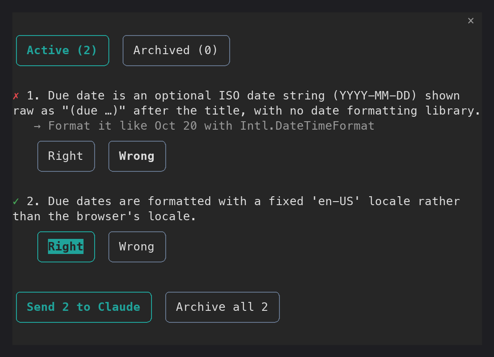
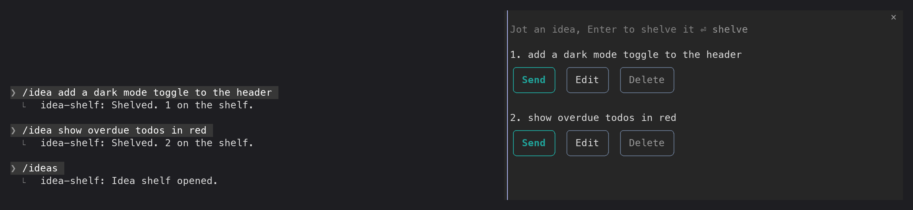
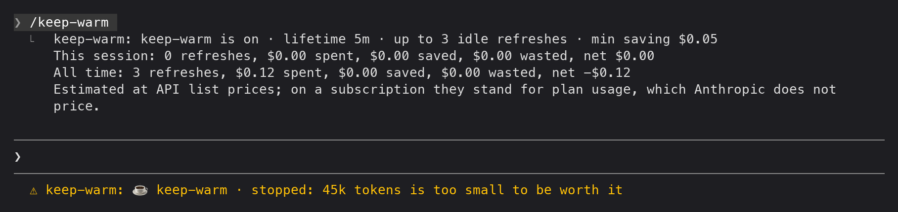
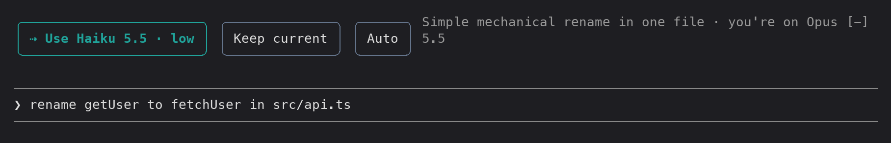
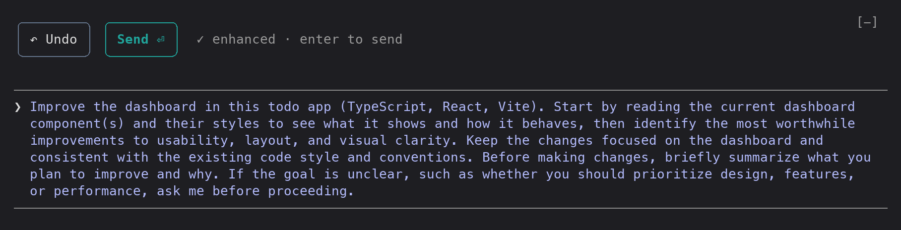

# mods

Claude Code mods: plugins that change Claude's interface or behaviour through hooks.

| Mod | What it does |
|---|---|
| [assumptions](assumptions/) | Gives Claude a `log_assumption` tool and asks it to log the non-obvious assumptions it makes while building. You confirm or correct them from a side pane (`/assumptions`). See its [README](assumptions/README.md). |
| [context-meter](context-meter/) | Shows what is filling your context window above the prompt: a gauge with the compaction point marked and a ledger of who put each part there (built in, your setup, the conversation) and what's left. `/context-meter` shows or hides it. See its [README](context-meter/README.md). |
| [cross-session](cross-session/) | Shows the messages passing between your Claude sessions and agents in a pane, lets you mute a peer, redacts secrets from outgoing messages and sends one by hand. `/cross-session` opens it. See its [README](cross-session/README.md). |
| [idea-shelf](idea-shelf/) | Parks side-ideas while Claude works so they don't derail the task. `/idea <text>` shelves one; `/ideas` opens the shelf, where each idea can be sent to a new Claude session, edited or deleted. See its [README](idea-shelf/README.md). |
| [keep-warm](keep-warm/) | Keeps the prompt cache warm while you're away by refreshing it shortly before it expires, only when the expected saving pays for it and for 3 refreshes at most. `/keep-warm` shows what it has spent and saved. See its [README](keep-warm/README.md). |
| [model-router](model-router/) | Recommends the right model and effort for each prompt in a band above the prompt, where one press applies or dismisses it. Auto mode routes every prompt. You can override any pick, and Exit auto is always one press away. `/model-router` toggles auto. See its [README](model-router/README.md). |
| [prompt-sharpener](prompt-sharpener/) | Rewrites your draft into a sharper, project-aware prompt in the input box. When a draft is too thin it asks 3 clarifying questions first, in a side pane, and you answer them in the prompt box. Nothing is sent until you press Send. See its [README](prompt-sharpener/README.md). |

## Examples

Screenshots from a live session in a small React todo app. Each mod's README has more.

### assumptions

Claude logged two assumptions while adding due dates. One is marked wrong with a correction, the other confirmed, ready to send back:



### context-meter

After one question: 45k of 1M used, split into built in, your setup and conversation, with 922k left before compaction.


### idea-shelf

Two ideas shelved with `/idea`, then `/ideas` opens the shelf:



### keep-warm

`/keep-warm` reports spend and savings. The status line says why it won't refresh a 45k-token conversation:



### model-router

A simple rename typed on Opus 5.5 gets a Haiku 5.5 · low recommendation:



### prompt-sharpener

`make the dashboard better`, after `ctrl+x e`:



## Setup

This repo is the source of truth. `~/mods` is a symlink to it, and `~/.claude/settings.json` loads each mod from there:

```json
"env": {
  "CLAUDE_CODE_PLUGIN_DIRS": "~/mods/prompt-sharpener:~/mods/assumptions:~/mods/context-meter:~/mods/idea-shelf:~/mods/model-router:~/mods/keep-warm:~/mods/cross-session"
}
```

On a new machine:

```sh
git clone git@github.com:NoteNerdOfficial/mods.git ~/Documents/Repos/mods
ln -s ~/Documents/Repos/mods ~/mods
```

Then add the `CLAUDE_CODE_PLUGIN_DIRS` line above. To try a single mod without installing it, run `claude --plugin-dir <mod folder>`.

## Layout

Each mod is a folder with:

- `.claude-plugin/plugin.json`: the name, version and description.
- `hooks/register.tsx`: the hook handlers.
- `types/index.d.ts`: the mod's own types.
- `docs/`: the screenshots its README uses.

The `.claude-plugin/types/` folder holds Claude Code's generated type definitions. It is gitignored.

## Tests

```sh
claude plugin test assumptions
claude plugin test context-meter
claude plugin test idea-shelf
claude plugin test keep-warm
claude plugin test model-router
claude plugin test prompt-sharpener
```

## License

[MIT](LICENSE)
