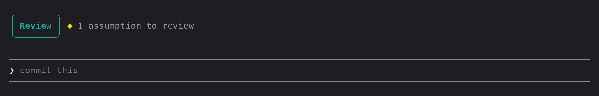

# assumptions

A Claude Code mod that has Claude log the assumptions it makes while it works, so you can confirm or correct them afterwards instead of finding them in the code later. Logging never blocks Claude. It notes the assumption and keeps working.

## Example

Ask Claude to "add a due date to todos and show it next to each title". While it builds, it logs that it chose an optional ISO date string shown as-is, and a line appears above the prompt:

Press **Review** to open the pane. Here the first assumption is marked wrong with a correction, and the second is confirmed. **Send 2 to Claude** sends both verdicts back:

## Use

Each session, the mod gives Claude a `log_assumption` tool and asks it to call it whenever it makes a non-obvious choice you haven't confirmed. That could be a requirement, a default, a name, a library, a file location or how an edge case behaves. Trivial and already-confirmed choices are skipped.

Once something is logged, a line appears above the prompt: `◆ 2 assumptions to review   Review`. When nothing is waiting, it's hidden.

- **Review** (or `/assumptions`) opens the Assumptions pane. It lists every assumption from the session, marked `?` pending, `✓` right or `✗` wrong.
- **Right** confirms an assumption.
- **Wrong** marks it wrong and opens a box where you can type what it should be. Press Enter to save, or leave it empty to skip.
- **Send N to Claude** sends your verdicts as a message, with each one marked `CONFIRMED` or `WRONG` and any correction attached. Claude is asked to adjust the work for anything marked wrong.

Sent assumptions stay in the pane, dimmed, and can't be changed. New ones you review are sent the next time you press Send.

### Archive

The pane has two tabs: **Active** and **Archived**.

- **Archive all** (Active tab) moves every assumption on the active list into the archive, with its verdict, correction and sent state. Use it to clear the pane without losing anything.
- The archive is kept per project between sessions, so you can come back and review older assumptions later. `/assumptions archived` opens the pane on that tab.
- **Restore** (on each archived item) and **Restore all** move items back to the active list exactly as they were. An item that was already sent comes back dimmed.
- **Delete archive** is the only permanent action. It asks first: **Delete N** removes only the items you saw listed, and **Keep** cancels. Active assumptions are never deleted directly. Archive them first.

The active list lasts only for the session. Archive it if you want to keep it.

On mobile there's no text input, so add corrections from the terminal or desktop.

## Files

- `hooks/register.tsx` registers the tool, the `/assumptions` command and the prompt guidance, and renders the band and the pane. The guidance Claude sees is in `GUIDANCE`.
- `types/index.d.ts` defines the `Assumption` shape and the mod's stored state.
- `tests/assumptions.test.ts` logs two assumptions, confirms one, corrects the other and checks the message that gets sent, on both terminal and desktop. A second test archives, restores one and then all, cancels a delete and then confirms one, checking the stored archive at each step. Run it with `claude plugin test <this folder>`.

## Install elsewhere

Run `claude --plugin-dir <this folder>`. You can also copy the folder into a plugin marketplace repo.
