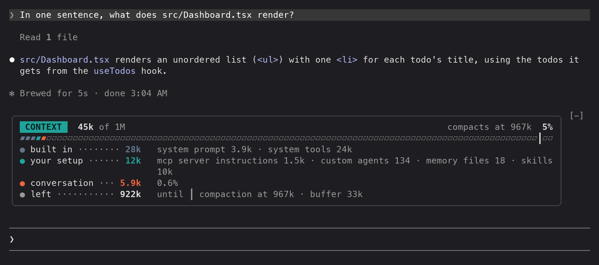

# context-meter

A Claude Code mod that shows what is filling your context window, above the prompt. It tells you how much of the window is used, who put it there, and how much room is left before auto-compaction runs.

## Example

After one short question in a fresh session, the meter shows 45k of a 1M window in use: 28k built in, 12k from your setup and 5.9k of conversation, with 922k left before compaction at 967k.



## Use

The meter appears above the prompt and refreshes after each turn and after a compaction:

```
╭──────────────────────────────────────────────────────────────────────────╮
│ CONTEXT   204k of 1M                                compacts at 950k  20% │
│ ▰▰▰▰▰▰▰▰▰▰▰▰▰▰▰▱▱▱▱▱▱▱▱▱▱▱▱▱▱▱▱▱▱▱▱▱▱▱▱▱▱▱▱▱▱▱▱▱▱▱▱▱▱▱▱▱▱▱▱▱▱▱▱▱▱▱▱▱▱▱┃▱▱▱ │
│ ● built in ········ 15k   system prompt 3.4k · system tools 12k          │
│ ● your setup ····· 2.6k   0.3%                                           │
│ ● conversation ··· 186k   19%                                            │
│ ● left ··········· 746k   until ┃ compaction at 950k · buffer 50k        │
╰──────────────────────────────────────────────────────────────────────────╯
```

- **The header** shows the tokens in use, the window size, where compaction runs and the percentage used. The percentage turns yellow at 70% of the compaction point and red at 90%.
- **The gauge** is the window drawn as cells, colored by owner. `┃` marks where auto-compaction runs, and the dim cells after it are the buffer.
- **The ledger** has a row per owner:
  - **built in** (slate): Claude Code's system prompt and tools.
  - **your setup** (teal): everything you added, such as MCP tools, memory files, skills and agents.
  - **conversation** (coral): the messages, the part that grows.
  - **left**: the room left before compaction, or before the window is full when auto-compaction is off.

  A row made of several parts lists them on the right. A row with one part shows its share of the window instead.

In a narrow window, rows wrap rather than cut off, and a wrapped ledger row continues under its detail. Below 20 columns the meter isn't drawn.

`/context-meter` shows or hides the meter. The choice is kept across sessions.

The numbers come from the same breakdown as `/context`, estimated locally. The mod makes no token-count API calls. Deferred tools aren't counted, because they aren't loaded into the window until used.

## Files

- `hooks/register.tsx` registers the `/context-meter` command, refreshes the reading after each turn, and draws the meter. The colors and glyphs are constants at the top.
- `types/index.d.ts` defines the `Reading`, `Slice`, `Group` and `Run` shapes.
- `tests/context-meter.test.tsx` checks the gauge, the ledger and the band, and that the meter refreshes after main turns and compactions but not subagent turns. Run it with `claude plugin test <this folder>`.

## Install elsewhere

Run `claude --plugin-dir <this folder>`. You can also copy the folder into a plugin marketplace repo.
