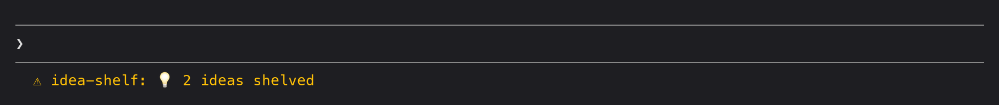

# idea-shelf

Park side-ideas while Claude works so they don't derail the current task, then send them when you're ready.

## Example

While Claude works on something else, shelve two ideas from the prompt:

```
/idea add a dark mode toggle to the header
/idea show overdue todos in red
```

The status line counts them:



`/ideas` opens the shelf beside the conversation. **Send** starts a new session on an idea, **Edit** moves it into the prompt and **Delete** removes it:


## Use


- `/ideas` (or `/idea` with nothing after it) opens the **Idea shelf** pane. Type an idea and press Enter to shelve it. Nothing goes to Claude.
- `/idea <text>` shelves an idea straight from the prompt.
- Each idea has three buttons:
  - **Send** starts a **new** Claude session on the idea, so your current session stays on its task. Inside cmux it opens in a background workspace in the project folder. Anywhere else it opens a new macOS Terminal window. If the launch fails, the idea stays on the shelf.
  - **Edit** moves it into the prompt box so you can change it first.
  - **Delete** removes it.
- The status line shows how many ideas are waiting. Each project has its own shelf, and the shelf is kept between sessions.
