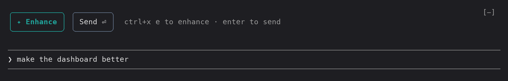

# prompt-sharpener

A Claude Code mod that rewrites a rough draft in the prompt box into a sharper prompt that knows about your project. The rewrite goes back into the box so you can review and edit it. It is sent only when you press **Send**.

## Example

In a small React todo app, type `make the dashboard better`. The button row appears above the prompt:



Press `ctrl+x e`. The draft is replaced by a rewrite that names the stack from `CLAUDE.md`, scopes the work and says when to ask. It stays in the box, tinted, until you send or undo it:


## Use

Start typing and a row of buttons appears above the prompt. Each button is its own rounded key, in the same teal and slate as context-meter. The button to press next is teal. When the box is empty the row is hidden.

```
╭───────────╮ ╭────────╮
│ ✦ Enhance │ │ Send ⏎ │  ctrl+x e to enhance · enter to send
╰───────────╯ ╰────────╯
```

- **Enhance**: press `ctrl+x e`, click it, or type `/enhance`. While it runs, a blue `✦ Enhancing…` key takes the row's place. The rewrite replaces your draft, tinted until your next edit. This never sends anything.
- After an enhancement the row reads `↶ Undo` `Send ⏎` `✓ enhanced`, and Send turns teal. **Undo** puts your original draft back.
- **Send** submits whatever is in the box right now, as your own message. Pressing Enter in the box does the same, so Send has no shortcut of its own.

You can also press `ctrl+x tab` to focus the row, move between the buttons with Tab or the arrows, and press Enter on one.

The `ctrl+x e` shortcut comes from `~/.claude/keybindings.json`. Mods can't define shortcut actions of their own, so the chord runs the mod's `/enhance` command instead, which leaves your draft in the box:

```json
{ "context": "Chat", "bindings": { "ctrl+x e": "command:enhance" } }
```

To change the key, edit that binding.

## Project context

Enhance reads these files from the session's working directory:

- `CLAUDE.md`, `.claude/CLAUDE.md` and `CLAUDE.local.md`, in full, up to 12k characters each. These hold the project's stack, conventions and terminology.
- `.claude/skills/*/SKILL.md`, but only each skill's `name` and `description`. That is enough to name the right skill without pulling in its whole procedure.

## When something goes wrong

If the model call fails, times out (45 s), or returns an empty reply, a toast tells you and your draft stays exactly as it was. If you edit the draft while Enhance is running, your edits are kept and the rewrite is thrown away. If a send fails, your text goes back into the box.

## Files

- `hooks/system-prompt.ts` holds the enhancer's instructions.
- `hooks/register.tsx` has the button row, the context gathering, and the enhance, undo and send logic. The model is set by `MODEL` (`sonnet`).
- `hooks/register.test.ts` runs tests using "make the dashboard better" against a fake project and model. Run it with `claude plugin test <this folder>`.

## Install elsewhere

Run `claude --plugin-dir <this folder>`. You can also copy the folder into a plugin marketplace repo.
